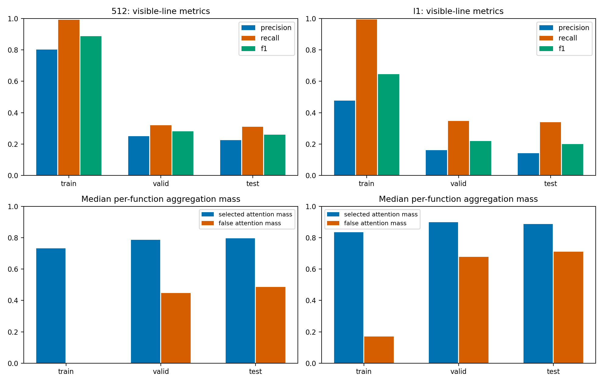
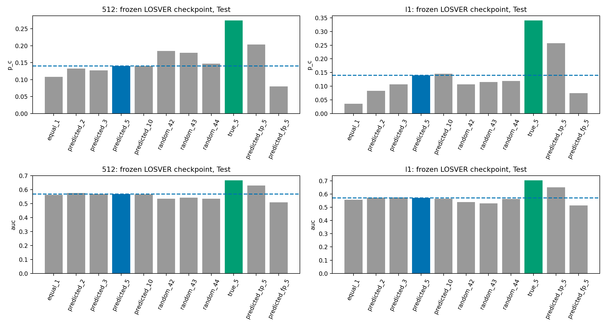
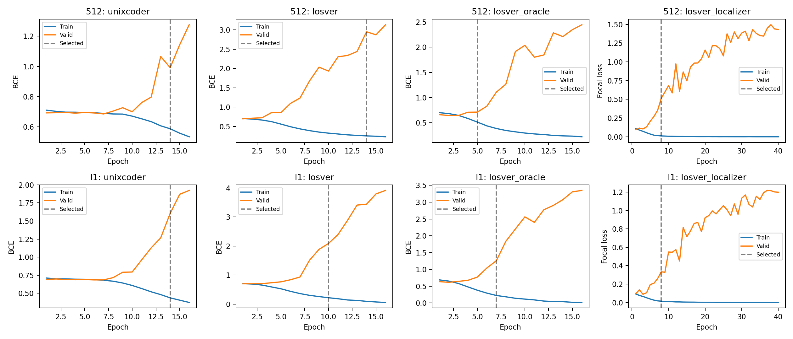
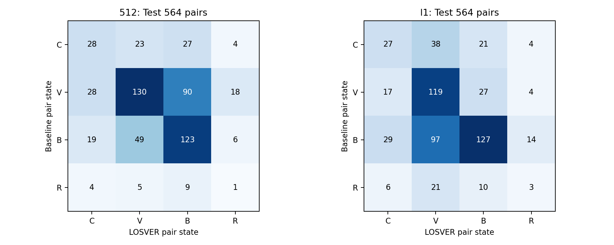
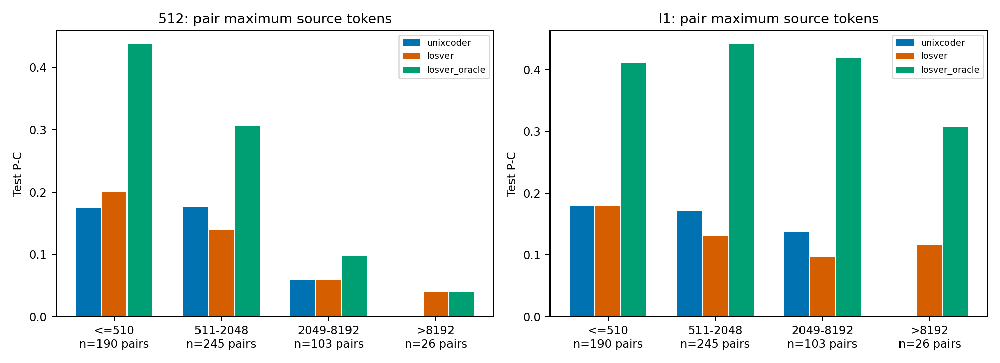

# LOSVER 512/L1 失败原因诊断

完成日期：2026-10-28。原实验来自提交 `67fc7b4`。本报告只做数据审计、既有 checkpoint 的冻结推理和统计分析；没有更新任何真实模型参数、数据成员、选模规则或分类阈值。

结论：证据最强的现象包括Diff监督的配对与任务语义问题、定位器明显的训练内—未见样本落差，以及Softmax放大后不同的聚合表示分布。这些现象与两阶段泛化失配的解释一致，但没有通过重新训练识别各原因的独立因果贡献。P-C 与 F1 的变化还包含明显的决策边界权衡。没有发现足以解释结果的 Padding、窗口重复计权、标签方向或分类头公平性错误。

## 1. 范围、分母与正式结果

官方原始 PrimeVul Paired Train/Valid/Test 为 **4354/562/564 对，即8708/1124/1128个函数**；每对按 `target=1,0` 排列。Baseline指本轮统一 UniXcoder mean-pooling + Linear 基线，不是其他 CodeBERT 实验。三组检测器保持 Seed123456、16 Epoch、有效函数Batch8；定位器40 Epoch。检测器仅按源Valid P-C选模，定位器按Valid修改行正类F1选模；概率严格 `>0.5` 判为漏洞。

| 输入 | 模型 | 选中Epoch | Test P-C | Accuracy | F1 | MCC | AUC | AUPRC |
| --- | --- | --- | --- | --- | --- | --- | --- | --- |
| 512 | Baseline | 14 | 14.54% | 55.59% | 58.15% | 0.1125 | 0.5729 | 0.5664 |
| 512 | LOSVER | 14 | 14.01% | 54.43% | 52.67% | 0.0889 | 0.5679 | 0.5669 |
| 512 | Oracle | 5 | 29.96% | 63.12% | 66.07% | 0.2665 | 0.7028 | 0.6765 |
| l1 | Baseline | 14 | 15.96% | 54.43% | 50.00% | 0.0901 | 0.5627 | 0.5630 |
| l1 | LOSVER | 10 | 14.01% | 54.79% | 58.13% | 0.0970 | 0.5701 | 0.5733 |
| l1 | Oracle | 7 | 42.02% | 69.15% | 72.12% | 0.3920 | 0.7423 | 0.6978 |

指标统一按 `sample_key/pair_key` 与官方成员逐项对齐。定位质量统计使用全部Train/Valid/Test行分数；检测器Train泛化探针固定为Seed42无放回抽取的512对（1024函数），Valid/Test则全量。所有检测器与所有干预使用完全相同的探针或评价成员。配置及Train探针成员见[config.json](config.json)。

Oracle读取配对Diff，是带后验信息的独立参考模型；普通LOSVER没有读取Test修复Diff。下文“GT/真实修改行”均指**原流程根据相邻成员生成的非空Diff删除行标签**，不是人工漏洞位置真值；错配成员产生的Diff也不应被当作可信修复区域。

## 2. 实现、公平性与数据核查

调用链：`train_losver → paired_rows/paired_loader → paired_features/paired_collate → paired_forward → LOSVERLocalizer/LOSVERDetector`；评价使用`evaluate_paired/validate_paired`，单函数推理使用`predict_paired`。源码见[data.py](../../vulnmechanism/data.py)、[model.py](../../vulnmechanism/model.py)、[training.py](../../vulnmechanism/training.py)、[evaluation.py](../../vulnmechanism/evaluation.py)。

| 检查项 | 状态 | 证据与边界 |
| --- | --- | --- |
| 原始划分、成员和概率方向 | 已证实一致 | 原始文件与当前函数、target、idx、project、commit逐项相同；标签1为漏洞，较大概率对应漏洞；没有额外删除或重采样。 |
| Token→物理行映射 | 已排除已覆盖范围内的错位 | 一次Fast Tokenization的offset映射；全量21920条函数—输入模式记录（10960函数×2）与缓存物理行号一致；CRLF、跨行Token、空行、末行有单元测试。 |
| L1核心区域与全覆盖 | 已证实 | 每个源码Token仅归属一个核心；上下文仅参与窗口编码；全量L1截断为0、配对编码相同为0。 |
| 窗口池化与Softmax | 已排除重复计权错误 | 局部Softmax乘窗口质量后等价于全部唯一核心代码Token的一个全局Softmax；没有等权平均窗口或重复计算上下文。 |
| Padding、特殊Token、纯空白 | 已排除当前聚合错误 | 这些位置在Softmax前为−∞，质量为0；编码器attention_mask屏蔽Padding，测试覆盖Padding不变性。 |
| 物理行跨窗口合并 | 已证实 | 按核心代码Token数量合并同一行，再分类一次；没有同一源码行的多个独立预测。 |
| 分类头与训练预算 | 已证实一致 | 三组检测器均为125339905参数、768→1线性头；同预训练路径、Seed、超参数及函数级更新次数；各自独立微调。 |
| 真实checkpoint重放与梯度 | 已证实 | 512六份Valid/Test重放最大概率误差0；L1≤1.20e−7，决策变化0。八个模型的源Train梯度检查均有限、编码器与头非零，定位器MHA梯度也非零。 |
| 选模、阈值和正常推理隔离 | 已排除 | 选中轮次与逐Epoch源Valid指标完全一致；没有阈值搜索；正常定位只读单函数源码；额外真值干预单独保存。 |
| 历史初始化的逐位重建 | 暂无法判断 | 最终权重不能独立恢复最初初始化状态；512没有保存last.pt、完整成员数组及逐Epoch AUC。依据代码、配置和缓存可核查规则一致，不伪补缺失字段。 |

定位缓存另用真实Localizer checkpoint做源代码重放：每个Split固定Seed42抽8对，两种输入共96个函数、9867条行分数，最大概率误差2.39e−7、行决策变化0。正式单函数接口还重放了每种输入的2个源Valid函数，最大误差1.20e−7、函数决策变化0；不读取Diff。成员与结果见[localizer_replay.json](localizer_replay.json)。

同一窗口一次计算全部Token Query的MHA，再取某行Query输出并求均值，与逐行Query、相同K/V的计算等价（定位头Dropout=0）。编码器Dropout配置仍为0.1，训练开启、推理关闭。L1仅做窗口内注意力及同一物理行合并；不同窗口间没有额外可学习的交互层。

当前统一线性头、代码Token聚合和正类F1选模是此前明确要求的修正版协议。作者原Baseline使用序列分类模型，而加权检测器读取聚合表示的首个分量；这些与当前共用线性头的协议不同，因此不将论文数值当作本轮公平对照。5/1经Softmax的定义与[作者加权实现](https://github.com/waroad/losver/blob/main/detection_primevul/run_weighted_primevul.py)一致。

### 2.1 截断输入冲突与旧统计

| Split组合 | 源码精确重复 | 512相同编码组 | 后一个Split涉及函数 | 含相反标签的编码组 | L1相同编码组 |
| --- | --- | --- | --- | --- | --- |
| train:valid | 0 | 18 | 33 | 16 | 0 |
| train:test | 0 | 13 | 29 | 13 | 0 |
| valid:test | 0 | 2 | 3 | 2 | 0 |

原始idx有5/4/2条重复，但sample_key唯一，所有连接均按sample_key/pair_key完成，未发生idx覆盖。512的训练—Test有13个相同截断编码、涉及29个Test函数；它们均含相反标签对应，属于信息冲突而非可靠标签线索。L1已消除这些编码重叠。本轮记录而不剔除成员。

`data/primevul_paired/statistics.json`保留的是更早映射协议的准备统计，不能用其中的旧可见行数解释当前输入。当前诊断使用源码与缓存重算的[functions.csv](functions.csv)、[data_audit.json](data_audit.json)，不覆盖原文件。

### 2.2 发现跨函数配对及Diff监督污染

| Split | 配对数 | CWE不一致 | big_vul_idx不一致 | 可提取两侧函数名 | 其中名称不一致 | 函数名未知 |
| --- | --- | --- | --- | --- | --- | --- |
| train | 4354 | 116 | 144 | 3122 | 36 | 1232 |
| valid | 562 | 0 | 0 | 426 | 13 | 136 |
| test | 564 | 0 | 0 | 412 | 5 | 152 |

元数据或名称不同只标记为候选，不能自动判错：合法重命名也会改变函数名，无法解析的宏/声明保持unknown。所有候选见[pair_metadata.csv](pair_metadata.csv)。表中unknown来自保守的函数名抽取，不是LOSVER编码失败或样本丢弃；模型不依赖AST解析。Train中144对占3.31%，贡献6068/49771=12.19%的Diff正类行；**这不是已证实错误率或梯度贡献率**。原准备流程只检查project和commit一致，不能验证它们真是同一函数的修复前后。

已核实至少两个跨函数例子：

- `primevul_paired:train:246`（函数493/494）：`do_siocgstamp`被配到`do_siocgstampns`。两侧生成各5个修改行，包括函数名、timeval/timespec类型和不同变量。原始[Linux提交ed6fe9d](https://github.com/torvalds/linux/commit/ed6fe9d614fc1bca95eb8c0ccd0e92db00ef9d5d)分别修复两个函数中的参数顺序，没有把一个函数重命名成另一个。因此这里的Diff包含了跨函数差异。

- `primevul_paired:train:309`（函数619/620）：`wvlan_set_station_nickname`被配到`wvlan_set_netname`，各生成13个修改行。[原始提交b5e2f33](https://github.com/torvalds/linux/commit/b5e2f339865fb443107e5b10603e53bbc92dc054)修复station-nickname路径；当前负例是另一个函数。

**已证实存在不可靠的Diff监督；它对最终性能的贡献尚未识别。** 普通函数BCE不使用训练配对Diff；定位器和Oracle会使用，预测版LOSVER间接受影响。当前实验成员、标签、模型和结果均未修改。

## 3. 定位器：训练内与未见样本的差异

| 输入/Split | 函数/可见行 | 正类行 | 预测正类行 | Precision | Recall | F1 | 无预测函数 |
| --- | --- | --- | --- | --- | --- | --- | --- |
| 512/train | 8708/318058 | 22627 | 28028 | 80.15% | 99.28% | 88.70% | 3108 |
| 512/valid | 1124/38745 | 2698 | 3462 | 24.96% | 32.02% | 28.05% | 366 |
| 512/test | 1128/40378 | 2719 | 3769 | 22.39% | 31.04% | 26.02% | 373 |
| l1/train | 8708/1311260 | 49771 | 103633 | 47.75% | 99.42% | 64.51% | 677 |
| l1/valid | 1124/137992 | 5401 | 11641 | 16.07% | 34.64% | 21.96% | 104 |
| l1/test | 1128/173669 | 5162 | 12467 | 14.07% | 33.98% | 19.90% | 105 |

以上Train预测来自选中的第8轮定位器对其自身训练成员的重放，不是out-of-fold预测。L1 Train行AUC=0.9970、AUPRC=0.9337，Test分别为0.7601、0.1265；Train宏F1（仅含有可见GT的函数）74.58%，Test20.25%。因此存在明显的训练内—未见样本落差，也不能说定位器完全没有可迁移信号：Test行AUPRC仍高于2.97%的正类先验。

| 输入/Split | 预测行数Q25/中位数/Q75/P90 | 最大值 |
| --- | --- | --- |
| 512/train | 0 / 1 / 4 / 9 | 51 |
| 512/valid | 0 / 2 / 5 / 8 | 34 |
| 512/test | 0 / 2 / 5 / 8 | 44 |
| l1/train | 2 / 5 / 11 / 23 | 8451 |
| l1/valid | 3 / 7 / 14 / 23 | 117 |
| l1/test | 3 / 8 / 14 / 24 | 136 |

L1 Test的105个无预测函数中，88个实际有Diff正类行、17个无Diff正类行；929个有GT的函数中437个完全未命中，另有492个至少命中一行。无预测只能解释部分漏检，其他函数会选择到错误位置。无预测时该checkpoint使用等权聚合，**不会恢复成另一个Baseline checkpoint**。

| L1 Split/函数标签 | 函数数 | P/R/F1 | 无GT函数 | 无预测函数 | 非Diff误选Token质量>50% |
| --- | --- | --- | --- | --- | --- |
| train/0 | 4354 | 54.31% / 99.46% / 70.26% | 74 | 45 | 862 |
| train/1 | 4354 | 39.35% / 99.36% / 56.37% | 1232 | 632 | 1340 |
| valid/0 | 562 | 22.12% / 38.81% / 28.18% | 3 | 44 | 341 |
| valid/1 | 562 | 9.02% / 26.50% / 13.46% | 163 | 60 | 401 |
| test/0 | 564 | 19.81% / 37.25% / 25.86% | 10 | 46 | 366 |
| test/1 | 564 | 7.72% / 27.20% / 12.03% | 189 | 59 | 416 |

函数标签虽然1:1平衡，行标签并不平衡：512 Train正类行占7.11%，L1降为3.80%；L1 Test仅2.97%。L1漏洞函数的Test定位Precision为7.72%，低于修复函数的19.81%。原Focal的pos_weight=5、alpha=0.8、gamma=1.5，在p=0.5时单条正/负行的损失比例是20倍；这是原定义，不是正负类反置，也不说明总梯度必由正类主导。

极长Train函数`primevul_paired:train:6574`产生8451条预测行；最长可见行函数占Train全部行1.83%。去掉最长可见行函数后，Train定位F1仍为67.25%，明显高于Test19.90%；该落差不是一个极端函数单独造成的。长度分层与集中程度保存在[line_metrics.json](line_metrics.json)和[length_concentration.json](length_concentration.json)。


[PDF](figures/localization_shift.pdf)

### 3.1 用同一行队列区分模型变化与覆盖范围变化

| Split/行队列 | 行/正类行 | Precision | Recall | F1 | AUC |
| --- | --- | --- | --- | --- | --- |
| valid/512_prefix | 38745/2698 | 24.96% | 32.02% | 28.05% | 0.7495 |
| valid/l1_prefix | 38745/2698 | 19.76% | 46.78% | 27.79% | 0.7601 |
| valid/l1_new | 99247/2703 | 11.59% | 22.53% | 15.31% | 0.7229 |
| test/512_prefix | 40378/2719 | 22.39% | 31.04% | 26.02% | 0.7151 |
| test/l1_prefix | 40378/2719 | 18.44% | 45.75% | 26.28% | 0.7406 |
| test/l1_new | 133291/2443 | 8.92% | 20.88% | 12.50% | 0.7083 |

Test旧512可见队列上，L1 F1=26.28%，与512的26.02%接近，Recall从31.04%提高到45.75%、Precision从22.39%降到18.44%。L1新增133291行中只有2443个正类（1.83%），Precision8.92%、Recall20.88%、F1=12.50%。不能把两个不同可见范围上的26.02%→19.90%直接解释为定位器在原队列上全面退化。

### 3.2 Diff任务与漏洞任务的语义差异

Test有189/564=33.51%的漏洞函数没有任何非空删除行，而其修复侧有修改行；例如修复仅新增保护条件。只有10对属于相反的“漏洞侧有修改、修复侧无修改”类型。于是Localizer的正类不是漏洞操作：原危险访问没有被删除时，仍可能被标为非修改行。源码位置与GT一致不等于标签具有漏洞因果意义。

训练内预测还产生可迁移性较弱的掩码统计：仅用“预测行数的负值”，AUC在Train/Valid/Test为0.6271/0.5547/0.5391；仅用“被选Token比例的负值”为0.6015/0.5300/0.5198。方向只用Train确定，没有拟合分类器或利用Test选方向。这支持掩码分布失配的观察，不能证明检测器只依赖这些统计量。完整数据见[mask_feature_auc.json](mask_feature_auc.json)。

## 4. 5/1加权：真实倍率、误选质量与冻结推理干预

设N为唯一有效代码Token数，选中比例为q。权重数值s/1经Softmax后，单Token倍率为`exp(s−1)`，选中Token总质量为 `M = q·exp(s−1)/(1−q+q·exp(s−1))`。s=2/3/5/10的倍率分别约2.72/7.39/54.60/8103.08，5/1并非线性5倍。此计算排除了Padding、特殊符号、纯空白与上下文副本。

| 输入/Split | 被选Token比例中位数 | 选中质量中位数 | GT Token总质量中位数 | 误选非Diff质量中位数 | 误选质量>50%函数 |
| --- | --- | --- | --- | --- | --- |
| 512/train | 4.78% | 73.29% | 51.66% | 0.00% | 681/8708 |
| 512/valid | 6.35% | 78.72% | 1.16% | 44.70% | 536/1124 |
| 512/test | 6.69% | 79.65% | 0.80% | 48.57% | 561/1128 |
| l1/train | 8.50% | 83.53% | 44.67% | 17.01% | 2202/8708 |
| l1/valid | 13.93% | 89.83% | 5.45% | 67.78% | 742/1124 |
| l1/test | 12.56% | 88.69% | 2.72% | 71.11% | 782/1128 |

L1 Test有782/1128=69.33%的函数，其被选中但不属于Diff的Token独占超过一半聚合质量。GT Token质量中位数从Train的44.67%降至Test的2.72%。这里的“误选”严格相对Diff定义；非Diff Token仍可能包含危险操作或上下文，不能把这些质量全部解释为有害或无关内容。被选状态也是上下文化表示，未加权的行仍可通过窗口Attention影响它。

### 4.1 固定LOSVER checkpoint，只替换推理池化策略

下列强度、随机Seed和规则在推理前固定。`random_*`在每个函数内无放回抽取与预测行数相同的可见物理行；不保证Token数相同。`predicted_tp/fp`只对相应Diff命中/误检行赋5，其他Token仍赋1，不删除源码。全部198组模型×Split×策略指标见[intervention_metrics.csv](intervention_metrics.csv)，逐函数Logit/概率见[512](interventions.512.csv)、[L1](interventions.l1.csv)。

| 冻结推理策略 | 512 P-C / AUC / F1 | L1 P-C / AUC / F1 |
| --- | --- | --- |
| equal_1 | 10.82% / 0.5622 / 58.88% | 3.55% / 0.5566 / 66.79% |
| predicted_2 | 13.30% / 0.5765 / 57.26% | 8.33% / 0.5712 / 66.96% |
| predicted_3 | 12.77% / 0.5694 / 54.38% | 10.64% / 0.5740 / 63.57% |
| predicted_5 | 14.01% / 0.5679 / 52.67% | 14.01% / 0.5701 / 58.13% |
| predicted_10 | 14.01% / 0.5663 / 52.28% | 14.54% / 0.5642 / 55.74% |
| random_42 | 18.44% / 0.5361 / 56.78% | 10.64% / 0.5398 / 65.17% |
| random_43 | 17.91% / 0.5426 / 57.12% | 11.52% / 0.5282 / 65.26% |
| random_44 | 14.72% / 0.5359 / 55.75% | 11.88% / 0.5618 / 66.20% |
| true_5 | 27.48% / 0.6673 / 62.33% | 34.04% / 0.7035 / 71.96% |
| predicted_tp_5 | 20.39% / 0.6300 / 60.54% | 25.71% / 0.6509 / 70.44% |
| predicted_fp_5 | 7.98% / 0.5095 / 50.62% | 7.45% / 0.5137 / 56.03% |

固定L1 LOSVER改用GT修改行时，P-C从79/564升至192/564（34.04%）、AUC从0.5701升至0.7035；只加权误检行时AUC为0.5137。只去掉误检加权、保留命中行时P-C为25.71%。这些干预支持位置质量与当前输出有关；并不等价于重新训练一个更好的检测器。

必须保留的退化与反例：L1直接等权后P-C仅3.55%，F1反而66.79%；其预测接近全部判漏洞。权重10的P-C略升至14.54%，但AUC降到0.5642。512随机行有时提高P-C而AUC下降。GT干预也丢失25个原本正确的配对，同时恢复138个错误配对；它不是逐样本单调改进。当前模型已经适应原加权训练分布，不能用等权推理的失败否定重新训练的等权Baseline。


[PDF](figures/inference_interventions.pdf)

### 4.2 检测器权重与定位信息的交叉替换

| 输入/冻结checkpoint | 等权 P-C / AUC | 预测行5/1 P-C / AUC | GT行5/1 P-C / AUC |
| --- | --- | --- | --- |
| 512/Baseline | 14.54% / 0.5729 | 12.77% / 0.5622 | 19.68% / 0.6086 |
| 512/LOSVER | 10.82% / 0.5622 | 14.01% / 0.5679 | 27.48% / 0.6673 |
| 512/Oracle | 4.08% / 0.5508 | 11.17% / 0.5669 | 29.96% / 0.7028 |
| l1/Baseline | 15.96% / 0.5627 | 14.01% / 0.5618 | 19.50% / 0.5900 |
| l1/LOSVER | 3.55% / 0.5566 | 14.01% / 0.5701 | 34.04% / 0.7035 |
| l1/Oracle | 3.90% / 0.5502 | 15.43% / 0.5698 | 42.02% / 0.7423 |

即使把同一GT权重交给不同checkpoint，结果也不同；例如L1 LOSVER+GT P-C=34.04%，独立训练Oracle为42.02%。差值涉及编码器和分类头的学习轨迹，不能按点数直接分摊为独立因果贡献。

### 4.3 Oracle的位置与数量因素

GT可见行数本身与标签有很强关联：用Train确定“行数越少越像漏洞”的方向，Test单特征AUC在512为0.6614、L1为0.7508。此特征需要配对Diff，普通单函数推理无法获得。Oracle收益因此不能直接作为“模型理解漏洞语义”的证据。

| 冻结Oracle策略 | 512 P-C / AUC | L1 P-C / AUC |
| --- | --- | --- |
| equal_1 | 4.08% / 0.5508 | 3.90% / 0.5502 |
| true_5 | 29.96% / 0.7028 | 42.02% / 0.7423 |
| random_lines_42 | 17.55% / 0.5599 | 18.97% / 0.5260 |
| random_lines_43 | 15.60% / 0.5109 | 16.84% / 0.5241 |
| random_lines_44 | 16.31% / 0.5441 | 20.04% / 0.5317 |
| random_tokens_42 | 12.23% / 0.5558 | 8.33% / 0.5448 |
| random_tokens_43 | 9.93% / 0.5412 | 8.87% / 0.5366 |
| random_tokens_44 | 12.59% / 0.5561 | 9.04% / 0.5567 |

数量匹配对照覆盖全部Valid/Test。随机行保持GT可见物理行数量；随机Token进一步严格保持GT唯一代码Token数量，因而保持选中比例及Softmax质量。L1在保持Token数、仅置乱位置后，AUC为0.5366–0.5567、P-C为8.33%–9.04%，低于原GT位置的0.7423/42.02%。**这些冻结对照排除了“当前Oracle完全不需要位置信息、只靠mask大小”的极端解释**；它们没有排除训练中同时使用后验统计关联，也不能消除Oracle的后验信息优势。对照配置与逐函数输出见[oracle_count_control.json](oracle_count_control.json)、[CSV](oracle_count_control.csv)。

## 5. 训练、校准与选模

| 输入/模型 | Epoch | 选中轮Train/Valid损失 | 最后轮Train/Valid损失 |
| --- | --- | --- | --- |
| 512/Baseline | 14 | 0.5876 / 0.9919 | 0.5347 / 1.2760 |
| 512/LOSVER | 14 | 0.2532 / 2.9519 | 0.2311 / 3.1355 |
| 512/Oracle | 5 | 0.5125 / 0.7109 | 0.2208 / 2.4470 |
| 512/Localizer | 8 | 0.0112 / 0.5127 | 0.0002 / 1.4317 |
| l1/Baseline | 14 | 0.4366 / 1.6058 | 0.3732 / 1.9227 |
| l1/LOSVER | 10 | 0.2165 / 2.0885 | 0.0540 / 3.9188 |
| l1/Oracle | 7 | 0.2238 / 1.2582 | 0.0166 / 3.3488 |
| l1/Localizer | 8 | 0.0142 / 0.3336 | 0.0004 / 1.1984 |

检测器是BCE，定位器是Focal，不能横向比较两种损失数值。训练日志是更新过程中的批均值，以下额外用同一选中checkpoint在固定Train探针、Valid/Test重算函数级平均BCE与AUC。定位器最终选中第8轮，不能把第40轮过拟合全部当作最终模型状态；第8轮已经存在明显训练内—未见样本差距。

| 输入/模型 | Train探针 AUC / BCE / P-C | Valid AUC / BCE / P-C | Test AUC / BCE / P-C |
| --- | --- | --- | --- |
| 512/Baseline | 0.7905 / 0.5293 / 38.87% | 0.5862 / 0.9919 / 16.19% | 0.5729 / 0.9783 / 14.54% |
| 512/LOSVER | 0.9616 / 0.2108 / 72.27% | 0.5637 / 2.9538 / 14.23% | 0.5679 / 2.6012 / 14.01% |
| 512/Oracle | 0.9120 / 0.3681 / 61.72% | 0.7166 / 0.7103 / 33.81% | 0.7028 / 0.7170 / 29.96% |
| l1/Baseline | 0.9346 / 0.3397 / 66.80% | 0.5828 / 1.6027 / 19.57% | 0.5627 / 1.5367 / 15.96% |
| l1/LOSVER | 0.9942 / 0.1072 / 90.43% | 0.5950 / 2.0929 / 19.93% | 0.5701 / 2.1663 / 14.01% |
| l1/Oracle | 0.9918 / 0.1161 / 90.82% | 0.7576 / 1.2525 / 47.69% | 0.7423 / 1.2561 / 42.02% |

L1 LOSVER在固定Train探针P-C=90.43%、AUC=0.9942，Test却为14.01%/0.5701；Baseline的Train探针P-C=66.80%。加权方法对训练样本的额外拟合没有转化为稳定Test收益。

| 输入/模型 | Test Brier | 10等宽概率箱ECE | p<.01或>.99比例 | 极端置信错误/全部错误 |
| --- | --- | --- | --- | --- |
| 512/Baseline | 0.2850 | 0.1384 | 7.54% | 30/501 |
| 512/LOSVER | 0.3579 | 0.2964 | 42.46% | 202/514 |
| 512/Oracle | 0.2274 | 0.0971 | 7.27% | 11/416 |
| l1/Baseline | 0.3255 | 0.2407 | 20.48% | 94/514 |
| l1/LOSVER | 0.3905 | 0.3668 | 41.93% | 195/510 |
| l1/Oracle | 0.2513 | 0.2155 | 38.74% | 102/348 |

L1 LOSVER的510个错误中195个处于p<.01或>.99，Brier=0.3905、ECE=0.3668，均差于Baseline。这是可观察的过度自信。单纯对Logit做正比例缩放不会改变0.5阈值下的符号，不能据此期待P-C自动改善；本轮没有实施校准。

L1三个检测器均完成17424个优化步、调度器last_epoch=17424；定位器为43560步，最终LR都为0。日志与10% warmup、2e−5峰值、线性衰减一致，没有发现学习率未更新或梯度断开的证据。三组检测器的分类头bias均约−0.021，不能只凭独立bias漂移解释Recall变化。详细状态见[fairness.json](fairness.json)。

Valid共1124函数，最后一批只有4个。`validate_paired`日志按批均分损失，而非按函数数加权；六个检测器的Valid BCE与逐函数平均最大差约0.0057。Test1128个函数正好组成141个满批。P-C/F1/AUC一直由全部预测计算，不受该日志口径差异影响；上表使用原始Logit重算的逐函数BCE。本轮记录该实现细节，不更改历史指标。

选模按约定执行：L1 LOSVER第10轮同时是Valid P-C和AUC最佳轮，不能把该模型失败简单归因于错选Epoch；Baseline/Oracle的Valid AUC最佳轮为9/4，而P-C选择14/7。512历史逐Epoch日志没有AUC，故不能判定其AUC选模稳定性。没有保存所有Epoch权重，不用Test反选轮次。


[PDF](figures/learning_curves.pdf)

## 6. 为什么Recall/F1提高而P-C没有提高

C=漏洞判漏洞且修复判安全；V=两侧均判漏洞；B=两侧均判安全；R=两侧反向。平衡配对上有 `Recall=P-C+P-V`、`FPR=P-V+P-R`、`Accuracy=P-C+(P-V+P-B)/2`。Pair ranking只要求z_v>z_p；P-C还要求两者分别位于0的两侧。

| 输入/模型 | C/V/B/R（分母564） | TP/TN/FP/FN（分母1128） | Recall | FPR | Logit配对排名正确率 |
| --- | --- | --- | --- | --- | --- |
| 512/Baseline | 82/266/197/19 | 348/279/285/216 | 61.70% | 50.53% | 46.45% |
| 512/LOSVER | 79/207/249/29 | 286/328/236/278 | 50.71% | 41.84% | 42.73% |
| 512/Oracle | 169/236/138/21 | 405/307/257/159 | 71.81% | 45.57% | 56.74% |
| l1/Baseline | 90/167/267/40 | 257/357/207/307 | 45.57% | 36.70% | 56.56% |
| l1/LOSVER | 79/275/185/25 | 354/264/300/210 | 62.77% | 53.19% | 63.65% |
| l1/Oracle | 237/213/93/21 | 450/330/234/114 | 79.79% | 41.49% | 78.55% |

L1从Baseline到LOSVER，TP增加97（257→354），FP也增加93（207→300），所以准确率仅净增加4/1128个函数，F1却从50.00%升到58.13%。P-V增加108对（167→275），而P-C减少11对（90→79）。具体有97对从B→V、27对从V→B：它们都仍只判对一侧，能够改变Recall/F1但不增加P-C。

配对层面，Baseline正确而LOSVER不正确63对；反向改善52对；共同正确27对；共同未达P-C有422对。函数层面，正例丢失56/恢复153个正确判断，负例丢失153/恢复60个正确判断。Oracle正确而LOSVER未达P-C有184对。512则是相反的Recall方向：LOSVER Recall从61.70%降到50.71%，不能把L1的阈值漂移解释原样套到512。

L1 LOSVER的Logit排名正确率63.65%，其中280/564对排名方向正确却未达P-C。512还有163对完全相同的编码，导致不可区分与排名平局；Sigmoid饱和额外制造概率平局，所以报告同时保留原始Logit和概率，不用Logit Gap替代分类收益。


[PDF](figures/pair_transitions.pdf)

| 比较 | P-C差（百分点） | P-C差95%配对Bootstrap区间 | AUC差95%区间 |
| --- | --- | --- | --- |
| 512/baseline_to_losver | -0.53 | [-4.08, +3.01] | [-0.0302, +0.0202] |
| l1/baseline_to_losver | -1.95 | [-5.67, +1.60] | [-0.0175, +0.0309] |

1000次完整配对Bootstrap、Seed42；没有按项目/提交聚类，也没有多Seed训练。因此可报告本队列上的负结果与缺乏稳定收益，不能宣称已经证明总体上显著退化。[uncertainty.json](uncertainty.json)还保存了跨输入及冻结GT干预的区间。

## 7. 512→L1：收益出现在哪里、损失出现在哪里

| 旧512输入是否相同 | 配对数 | 512 Baseline/LOSVER/Oracle P-C | L1 Baseline/LOSVER/Oracle P-C |
| --- | --- | --- | --- |
| 0 | 401 | 20.45% / 19.70% / 42.14% | 18.70% / 14.96% / 41.15% |
| 1 | 163 | 0.00% / 0.00% / 0.00% | 9.20% / 11.66% / 44.17% |

163对旧输入相同的样本，在512下三个模型P-C都为0。L1让Oracle在其中判对72对，但在其余401对从169降到165，净增68对；LOSVER在新可区分组判对19对，却在其余组从79降到60，净增为0。总P-C不变不表示成员不变：512→L1 LOSVER恢复56对、损失56对。这个固定分组的算术分解已证实，不能把每个退化都单独归因于新增上下文。

| 配对最大源码Token数 | 配对数 | 512→L1 Baseline P-C | 512→L1 LOSVER P-C | 512→L1 Oracle P-C |
| --- | --- | --- | --- | --- |
| <=510 | 190 | 17.37% → 17.89% | 20.00% → 17.89% | 43.68% → 41.05% |
| 511-2048 | 245 | 17.55% → 17.14% | 13.88% → 13.06% | 30.61% → 44.08% |
| 2049-8192 | 103 | 5.83% → 13.59% | 5.83% → 9.71% | 9.71% → 41.75% |
| >8192 | 26 | 0.00% → 0.00% | 3.85% → 11.54% | 3.85% → 30.77% |
| L1配对最大窗口数 | 配对数 | Baseline P-C | LOSVER P-C | Oracle P-C |
| --- | --- | --- | --- | --- |
| 1 | 190 | 17.89% | 17.89% | 41.05% |
| 2-4 | 210 | 16.67% | 14.29% | 43.33% |
| 5-16 | 127 | 15.75% | 8.66% | 45.67% |
| 17+ | 37 | 2.70% | 10.81% | 27.03% |
| 输入/修改行可见性 | 配对数 | Baseline/LOSVER/Oracle P-C |
| --- | --- | --- |
| 512/complete | 315 | 22.54% / 19.68% / 44.13% |
| 512/none | 163 | 0.00% / 0.00% / 0.00% |
| 512/partial | 86 | 12.79% / 19.77% / 34.88% |
| l1/complete | 564 | 15.96% / 14.01% / 42.02% |

L1 Test全部修改行可见，不能再把失败归因于输入仍被截断。新增Token区域平均获得38.20%的函数聚合质量，其中误选非Diff Token平均获得全函数质量的21.58%；246个函数的新增误选Token单独占比超过50%。旧前缀误选Token仍平均占39.15%，说明噪声并不只来自新增区域。详见[new_region_mass.csv](new_region_mass.csv)。

以命中情况分组：L1两侧均至少命中一行的153对，Baseline/LOSVER P-C为19.61%/16.34%；单侧命中的186对为19.35%/21.51%；完全未命中的225对为10.67%/6.22%。定位F1与分类方向收益的Spearman相关，在正/负函数分别约0.006/0.094；长度与标签内的完整分层见[quality_correlations.json](quality_correlations.json)。这些关联并不单调，也不是因果贡献。

长函数全覆盖还同时改变每轮Token/行数量、行正类先验、Micro-batch、梯度重计算及学习轨迹。各窗口独立编码、仅有限重叠上下文；检测器对窗口间信息做线性池化，没有显式长程交互。短函数两种输入本身相同而模型权重不同。当前证据能区分可见性、选择质量和输入规模，却不能在没有匹配重训的情况下独立估计跨窗口交互不足的贡献。>8192组仅26对，不据其局部变化宣称稳定优势。


[PDF](figures/length_strata.pdf)

## 8. 人工可核查的典型配对

以下行号均为**1-based**；底层训练缓存仍为0-based。先统计全部564对，再选最短且不重复的符合条件案例，属于按结果选择的说明性样本，不代表总体发生率，不参与参数或队列选择。D=Diff标签，P=预测修改行。完整7类案例、两种输入6个模型概率和行分数见[cases.json](cases.json)。

### 案例1：primevul_paired:test:444（baseline_correct_losver_wrong）

符合此条件的配对：63/564。

| sample_key/标签 | Baseline概率 | LOSVER概率 | Oracle概率 | 固定LOSVER+GT概率 | GT/预测行数 |
| --- | --- | --- | --- | --- | --- |
| primevul_paired:test:889/1 | 0.999986 | 0.965351 | 0.999834 | 0.977604 | 0/2 |
| primevul_paired:test:890/0 | 5.10938e-08 | 0.592782 | 4.33854e-06 | 4.91593e-07 | 1/3 |

修复新增`end-p<4`保护，而读取p[0..3]的语句保留。修复侧保护行被命中，但签名和读取行也被选中，非Diff误选Token占83.54%质量。固定LOSVER只加权GT后，修复概率从0.5928降到4.92e−7，恢复正确分类。这支持本例中加权位置影响误报；不把原危险读取行简单视为语义无用。

`primevul_paired:test:889`；project=php-src；commit=b6fe458ef9ac1372b60c3d3810b0358e2e20840d。

```text
行号 D P 分数    源码
   1 0 1 0.647  utf32be_mbc_to_code(const UChar* p, const UChar* end ARG_UNUSED)
   2 0 0 0.055  {
   3 0 1 0.937    return (OnigCodePoint )(((p[0] * 256 + p[1]) * 256 + p[2]) * 256 + p[3]);
   4 0 0 0.104  }
```

`primevul_paired:test:890`；project=php-src；commit=b6fe458ef9ac1372b60c3d3810b0358e2e20840d。

```text
行号 D P 分数    源码
   2 0 0 0.075  {
   3 1 1 0.909    if (end - p < 4) return 0;
   4 0 1 0.916    return (OnigCodePoint )(((p[0] * 256 + p[1]) * 256 + p[2]) * 256 + p[3]);
```

### 案例2：primevul_paired:test:338（baseline_wrong_losver_correct）

符合此条件的配对：52/564。

| sample_key/标签 | Baseline概率 | LOSVER概率 | Oracle概率 | 固定LOSVER+GT概率 | GT/预测行数 |
| --- | --- | --- | --- | --- | --- |
| primevul_paired:test:677/1 | 0.971642 | 0.92231 | 0.806166 | 0.961703 | 0/2 |
| primevul_paired:test:678/0 | 0.918923 | 0.0901643 | 0.892523 | 1.23484e-12 | 1/4 |

修复新增remove_inode_hash。LOSVER成功把两侧分开，Baseline和独立Oracle却均判漏洞；因此Oracle不是逐样本上界，非Diff质量高也不必然失败。只保留误检加权会使修复侧概率回升至0.9728，说明本例中少量命中位置仍然重要。

`primevul_paired:test:677`；project=linux；commit=775c5033a0d164622d9d10dd0f0a5531639ed3ed。

```text
行号 D P 分数    源码
   1 0 1 0.837  static inline void fuse_make_bad(struct inode *inode)
   2 0 0 0.430  {
   3 0 1 0.910  	set_bit(FUSE_I_BAD, &get_fuse_inode(inode)->state);
   4 0 0 0.275  }
```

`primevul_paired:test:678`；project=linux；commit=775c5033a0d164622d9d10dd0f0a5531639ed3ed。

```text
行号 D P 分数    源码
   2 0 1 0.521  {
   3 1 1 0.902  	remove_inode_hash(inode);
   4 0 1 0.865  	set_bit(FUSE_I_BAD, &get_fuse_inode(inode)->state);
```

### 案例3：primevul_paired:test:370（oracle_correct_losver_wrong）

符合此条件的配对：184/564。

| sample_key/标签 | Baseline概率 | LOSVER概率 | Oracle概率 | 固定LOSVER+GT概率 | GT/预测行数 |
| --- | --- | --- | --- | --- | --- |
| primevul_paired:test:741/1 | 0.108643 | 0.0860539 | 0.888725 | 0.905481 | 0/5 |
| primevul_paired:test:742/0 | 5.57499e-05 | 1.2531e-07 | 7.92747e-13 | 1.74217e-15 | 1/6 |

修复新增lock_guard。漏洞侧没有Diff正类，定位器却选择了查询及返回区域，将漏洞概率从同checkpoint等权的0.9055压到0.0861；固定GT干预恢复为0.9055。修复侧锁行的预测分数0.524，已经命中；失败并非仅由“没有预测到锁”解释。

`primevul_paired:test:741`；project=EternalTerminal；commit=900348bb8bc96e1c7ba4888ac8480f643c43d3c3。

```text
行号 D P 分数    源码
   1 0 0 0.412  TerminalUserInfo UserTerminalRouter::getInfoForId(const string &id) {
   2 0 1 0.732    auto it = idInfoMap.find(id);
   3 0 1 0.612    if (it == idInfoMap.end()) {
   4 0 1 0.772      STFATAL << " Tried to read from an id that no longer exists";
```

`primevul_paired:test:742`；project=EternalTerminal；commit=900348bb8bc96e1c7ba4888ac8480f643c43d3c3。

```text
行号 D P 分数    源码
   1 0 0 0.473  TerminalUserInfo UserTerminalRouter::getInfoForId(const string &id) {
   2 1 1 0.524    lock_guard<recursive_mutex> guard(routerMutex);
   3 0 1 0.762    auto it = idInfoMap.find(id);
```

### 案例4：primevul_paired:test:352（newly_distinguishable_oracle_gain）

符合此条件的配对：61/564。

| sample_key/标签 | Baseline概率 | LOSVER概率 | Oracle概率 | 固定LOSVER+GT概率 | GT/预测行数 |
| --- | --- | --- | --- | --- | --- |
| primevul_paired:test:705/1 | 0.322493 | 0.0122554 | 0.999585 | 0.998124 | 0/11 |
| primevul_paired:test:706/0 | 0.440606 | 0.688998 | 0.054594 | 0.961131 | 2/11 |

旧512下两侧输入相同，LOSVER概率均为0.4794。L1完整看见新增的nft_chain_is_bound检查，但修复侧第52/53行分数0.482/0.384，低于0.5，属于漏检而非行号错位。L1 LOSVER给出反向判断，Oracle给出正确两侧判断；固定LOSVER换GT后修复侧仍为0.9611，表明这例还涉及学到的编码器/分类头，不能只修mask就假定解决。

`primevul_paired:test:705`；project=linux；commit=e02f0d3970404bfea385b6edb86f2d936db0ea2b。

```text
行号 D P 分数    源码
   8 0 0  --
   9 0 1 0.543  	err = nla_parse_nested_deprecated(tb, NFTA_VERDICT_MAX, nla,
  10 0 1 0.523  					  nft_verdict_policy, NULL);
  11 0 1 0.549  	if (err < 0)
```

`primevul_paired:test:706`；project=linux；commit=e02f0d3970404bfea385b6edb86f2d936db0ea2b。

```text
行号 D P 分数    源码
  51 0 1 0.532  			return -EOPNOTSUPP;
  52 1 0 0.482  		if (nft_chain_is_bound(chain))
  53 1 0 0.384  			return -EINVAL;
  54 0 1 0.545  		if (desc->flags & NFT_DATA_DESC_SETELEM &&
```

### 案例5：primevul_paired:test:438（no_prediction_oracle_correct）

符合此条件的配对：11/564。

| sample_key/标签 | Baseline概率 | LOSVER概率 | Oracle概率 | 固定LOSVER+GT概率 | GT/预测行数 |
| --- | --- | --- | --- | --- | --- |
| primevul_paired:test:877/1 | 0.979107 | 0.999996 | 0.824904 | 0.999915 | 1/0 |
| primevul_paired:test:878/0 | 0.910092 | 0.999991 | 9.63118e-06 | 0.853886 | 1/0 |

修改为qemu_receive_packet调用。两侧都没有预测行，LOSVER退化为自身等权表示并以约0.99999把两侧均判漏洞；这不等于Baseline回退。即使在该LOSVER上加GT，修复侧仍为0.8539，真实位置也不能保证这个已训练头会正确利用差异。

`primevul_paired:test:877`；project=qemu；commit=1caff0340f49c93d535c6558a5138d20d475315c。

```text
行号 D P 分数    源码
   7 0 0 0.269      if (s->phy_reg[PHY_CTRL] & MII_CR_LOOPBACK) {
   8 1 0 0.305          nc->info->receive(nc, buf, size);
   9 0 0 0.040      } else {
```

`primevul_paired:test:878`；project=qemu；commit=1caff0340f49c93d535c6558a5138d20d475315c。

```text
行号 D P 分数    源码
   7 0 0 0.349      if (s->phy_reg[PHY_CTRL] & MII_CR_LOOPBACK) {
   8 1 0 0.327          qemu_receive_packet(nc, buf, size);
   9 0 0 0.047      } else {
```

### 案例6：primevul_paired:test:61（frozen_true_lines_hurt_correct_pair）

符合此条件的配对：25/564。

| sample_key/标签 | Baseline概率 | LOSVER概率 | Oracle概率 | 固定LOSVER+GT概率 | GT/预测行数 |
| --- | --- | --- | --- | --- | --- |
| primevul_paired:test:123/1 | 0.462323 | 0.948096 | 0.0954385 | 0.000116512 | 1/6 |
| primevul_paired:test:124/0 | 0.681185 | 0.133405 | 5.9783e-06 | 1.10977e-07 | 1/5 |

修改点为alloc_size的int→size_t。原LOSVER配对正确，但只加权GT后漏洞侧概率从0.9481降到0.0001165，导致新错误。这是25个“GT干预损失既有正确配对”中的一例，反驳逐样本单调改善，也说明不能把表示或Logit变化直接解释为学习收益。

`primevul_paired:test:123`；project=tensorflow；commit=a1e1511dde36b3f8aa27a6ec630838e7ea40e091。

```text
行号 D P 分数    源码
   1 0 1 0.501  TfLiteIntArray* TfLiteIntArrayCreate(int size) {
   2 1 1 0.905    int alloc_size = TfLiteIntArrayGetSizeInBytes(size);
   3 0 1 0.894    if (alloc_size <= 0) return NULL;
```

`primevul_paired:test:124`；project=tensorflow；commit=a1e1511dde36b3f8aa27a6ec630838e7ea40e091。

```text
行号 D P 分数    源码
   1 0 0 0.460  TfLiteIntArray* TfLiteIntArrayCreate(int size) {
   2 1 1 0.900    size_t alloc_size = TfLiteIntArrayGetSizeInBytes(size);
   3 0 1 0.887    if (alloc_size <= 0) return NULL;
```

## 9. 原因优先级与证据等级

| 优先级 | 问题/假说 | 状态 | 依据与不能推出的结论 |
| --- | --- | --- | --- |
| P0 | 至少两对原始Train成员跨函数，Diff包含非修复差异 | 已证实 | 原始提交核实了不同函数分别修复；144对元数据候选不能自动判错。 |
| P0 | 不可靠Diff是主要性能损害来源 | 数据支持但未证实 | 候选涉及12.19%正类行；没有清理监督后匹配重训来估计效果。 |
| P1 | 训练内定位预测与未见样本预测不匹配 | 已证实 | L1 Train/Test F1=64.51%/19.90%，GT质量中位数44.67%/2.72%；没有OOF训练对照来确定分类影响份额。 |
| P1 | 54.6倍Token放大使非Diff误选Token支配聚合 | 已证实 | Test非Diff误选质量主导782个函数；GT干预净恢复113对，但也损失25对；不等于新训练必获益。 |
| P1 | 独立BCE及边界位置不足以改善配对判别 | 已证实 | 97对B→V；TP+97同时FP+93，准确率仅净增4函数，P-C反降11对。 |
| P2 | 检测器过拟合、概率极端化 | 已证实 | 同一选中checkpoint Train探针AUC0.9942而Test0.5701，ECE0.3668；具体由哪种优化因素造成尚不独立识别。 |
| P2 | 新增可见区的有效定位不足 | 已证实 | 新增行F1=12.50%；LOSVER解锁19个旧不可区分对、却在其余组净损失19；Oracle解锁72个。 |
| P2 | Diff任务等同漏洞位置任务 | 已排除 | 189个漏洞函数无删除行标签，仍有真实危险操作；非Diff位置可以提供有效上下文。 |
| P3 | 当前Oracle完全只靠mask大小、不依赖位置 | 已排除 | 位置置乱、保持唯一Token数后，AUC降到0.5366–0.5567；但GT行数本身确有0.7508 AUC，不能忽略后验关联。 |
| P3 | Padding/重复窗口/概率反向/头不一致/正常Test读Diff | 已排除 | 全量对齐、原预测重放、源Train梯度、53项单元测试和单函数隔离测试一致。 |
| P3 | 错选Epoch是L1 LOSVER失败主因 | 已排除 | 选中第10轮同时为其Valid P-C和AUC最大值；多Seed稳定性仍未验证。 |
| 未定 | 缺少更强跨窗口交互是主要原因 | 暂无法判断 | 代码限制已知，但没有只改变交互的匹配实验，Oracle收益也说明简单池化能够利用部分额外信息。 |
| 未定 | 所有失败都来自错误漏洞标签或错误初始化 | 暂无法判断 | 没有逐样本安全真值审计、也未保存初始状态；当前证据不足，不能凭低性能推断。 |

### 不超过三项优先验证方向（仅建议，本轮未实施）

| 顺序 | 待验证问题 | 最小验证方式 | 预计成本 |
| --- | --- | --- | --- |
| 1 | 配对与Diff监督可信度 | 先核验Train的元数据/名称候选，依据原提交区分合法重命名和跨函数错配；仅处理已核实问题。随后以同一函数BCE成员、初始化和预算比较原Diff与核验后监督，不自动按标志删除样本。 | 核验本身0 GPU、CPU分钟级，人工成本取决于候选；若做1024函数/3轮Pilot，约1–3 GPU小时。 |
| 2 | 训练内mask质量优势是否导致后级失配 | Train内部按pair_key做两折交叉预测，避免修复对两侧跨折；比较同预算的训练内预测与OOF预测，不更动正式Valid/Test。 | 1024函数/3轮的2折定位器及检测器Pilot约2–4 GPU小时；全量40轮代价明显更高。 |
| 3 | 指数倍率与训练适应的作用 | 从相同预训练初始化，预设1/2/5三种权重独立训练检测器，保持原定位缓存、成员、步数；仅按源Valid选模，重复少量Seed，不按本次Test表选“最佳强度”。 | 1024函数/3轮、3权重×少量Seed约4–8 GPU小时；估计基于现有吞吐并受窗口数影响，非实测。 |

这三项按顺序验证，不在本轮叠加模块。当前证据优先支持检查监督与训练/推理匹配；没有依据直接开展更大的新网络或全量方法搜索。

## 10. 实际执行、开销与复现

| 输入/检测器 | 诊断秒数 | 本进程峰值allocated GiB | 原预测最大误差 | 参数未改变 |
| --- | --- | --- | --- | --- |
| 512/Baseline | 91.5 | 1.568 | 0 | 是 |
| 512/LOSVER | 91.5 | 1.562 | 0 | 是 |
| 512/Oracle | 110.4 | 1.562 | 0 | 是 |
| l1/Baseline | 539.0 | 4.003 | 1.19e-07 | 是 |
| l1/LOSVER | 515.2 | 3.999 | 1.19e-07 | 是 |
| l1/Oracle | 525.1 | 3.999 | 1.19e-07 | 是 |

耗时包含加载、分词、11种池化读出、重放检查及两个源Train函数的梯度检查；不包含已经缓存的定位器全量预测生成时间。每个checkpoint的编码结果供多个池化策略复用，另对首批及长窗口批次调用正式forward核对。峰值包含梯度检查，不能当作原完整训练显存或端到端LOSVER吞吐；两个GPU并行运行，秒数不相加充当壁钟时间。

真实模型没有建立优化器，也没有更新参数；完整state_dict与加载的checkpoint逐张量相等。定位器的源Train梯度也在eval模式下检查，Dropout关闭；真实训练模式/梯度重计算的正确性由现有测试另行覆盖。固定干预中参数与输入保持一致，可以识别该checkpoint的池化敏感性，不能识别重新训练后的收益。

执行检查：全套53项单元测试、最终诊断用例复验、py_compile及Git差异检查；详见[unit-tests.log](unit-tests.log)。原正式结果未覆盖，模型权重与原始数据未上传。

复现命令（在仓库根目录，使用vul-detect环境和现有本地checkpoint）：

```bash
python -m vulnmechanism.losver_diagnosis statistics
python -m vulnmechanism.losver_diagnosis inference --mode 512 --device cuda:0
python -m vulnmechanism.losver_diagnosis inference --mode l1 --device cuda:1
python -m vulnmechanism.losver_diagnosis oracle-control --device cuda:0
python -m vulnmechanism.losver_diagnosis replay --device cuda:0
MPLCONFIGDIR=/tmp/vul-detect-matplotlib python -m vulnmechanism.losver_diagnosis analysis
python -m unittest discover -s tests -v
```

统计/推理实现为[losver_diagnosis.py](../../vulnmechanism/losver_diagnosis.py)，复用正式data/model/training/evaluation及pooling。`analysis`生成CSV、统计JSON、案例及图；本Markdown包含人工核查原始提交后的解释。环境为Python3.11.14、PyTorch2.9.1+cu128、Transformers4.57.3、RTX4090、FP32 eager，绘图Matplotlib3.10.8。

数据与证据入口：[逐函数特征](functions.csv)、[行级完整统计](line_metrics.json)、[同一行队列比较](common_line_metrics.json)、[配对元数据](pair_metadata.csv)、[学习轨迹](training_analysis.json)、[配对状态](pair_transitions.json)、[分层结果](strata.csv)、[干预指标](intervention_metrics.csv)、[GT数量控制](oracle_count_control_metrics.csv)、[不确定性](uncertainty.json)、[典型案例](cases.json)。
