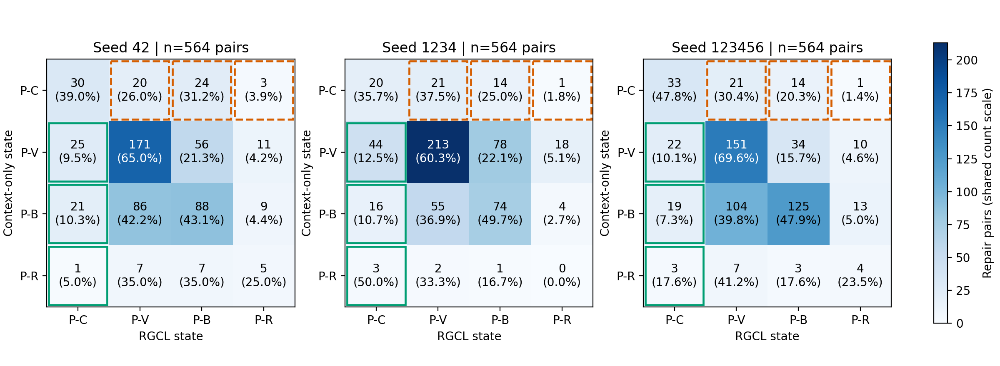

# RQ3: Repair-Guided Pairwise Classification Analysis

**研究问题：修复引导如何改变漏洞函数及其修复版本的实际二分类结果？**

在固定Test协议下，RGCL的P-C从11.94±1.88%提高到14.01±0.61%，每个种子平均新增51.33±10.21对P-C、丢失39.67±6.35对，净增加11.67±13.87对，即2.07±2.46个百分点。新增正确配对主要来自纠正修复版本误报；完整结果也显示新的误报和漏检，不能将P-C收益解读为全面改善。

## 协议与定义

使用PrimeVul官方完整Test的564对/1128个函数，UniXcoder，Seed42、1234、123456，Context-only与RGCL。复用原完整Valid P-C选出的六个checkpoint对应的保存预测；不训练、不编码、不重新推理，不选择模型、Epoch或阈值。函数判定始终为严格 `prob > 0.5`，等于0.5判正常。RGCL保留512 Token、K=5、λ=0.1及Token加权Diff区域损失。

P-C=(漏洞,正常)，两侧均正确；P-V=(漏洞,漏洞)，修复侧误报；P-B=(正常,正常)，漏洞侧漏检；P-R=(正常,漏洞)，两侧均错误。每个转移矩阵的行是Context-only状态，列是RGCL状态。

统计以完整sample_key和pair_key对齐，核对标签、预测、保存的物理行/Token映射及所选Epoch。每个种子矩阵总数必须为564，行合计与Context-only原指标一致，列合计与RGCL原指标一致。三种子均值±样本标准差（ddof=1）的统计单位是种子；三个模型重复评价同一批564对，不将其计为1692个独立配对。

## 1. 配对分类结果

| 种子 | 方法 | P-C对数 | P-V | P-B | P-R | P-C | 漏洞Recall | 修复侧FPR |
|---:|---|---:|---:|---:|---:|---:|---:|---:|
| 42 | context_only | 77 | 263 | 204 | 20 | 13.65% | 60.28% | 50.18% |
| 42 | rgcl | 77 | 284 | 175 | 28 | 13.65% | 64.01% | 55.32% |
| 1234 | context_only | 56 | 353 | 149 | 6 | 9.93% | 72.52% | 63.65% |
| 1234 | rgcl | 83 | 291 | 167 | 23 | 14.72% | 66.31% | 55.67% |
| 123456 | context_only | 69 | 217 | 261 | 17 | 12.23% | 50.71% | 41.49% |
| 123456 | rgcl | 77 | 283 | 176 | 28 | 13.65% | 63.83% | 55.14% |

context_only三种子：P-C 11.94±1.88%，Recall 61.17±10.93%，修复侧FPR 51.77±11.17%。

rgcl三种子：P-C 14.01±0.61%，Recall 64.72±1.38%，修复侧FPR 55.38±0.27%。

## 2. 新增正确配对及分类退化

前三列括号为占该种子新增P-C的比例；新增、丢失和净增加括号为占完整564对的比例。均值行的比例先在每个种子内计算，再取均值和标准差，不采用跨种子次数合并后的比例。

| 种子 | P-V→P-C | P-B→P-C | P-R→P-C | 新增P-C | 丢失P-C | 净增加P-C |
|---:|---:|---:|---:|---:|---:|---:|
| 42 | 25 (53.19%) | 21 (44.68%) | 1 (2.13%) | 47 (8.33%) | 47 (8.33%) | 0 (0.00%) |
| 1234 | 44 (69.84%) | 16 (25.40%) | 3 (4.76%) | 63 (11.17%) | 36 (6.38%) | 27 (4.79%) |
| 123456 | 22 (50.00%) | 19 (43.18%) | 3 (6.82%) | 44 (7.80%) | 36 (6.38%) | 8 (1.42%) |
| 均值±SD | 30.33±11.93 (57.68±10.65%) | 18.67±2.52 (37.75±10.73%) | 2.33±1.15 (4.57±2.35%) | 51.33±10.21 (9.10±1.81%) | 39.67±6.35 (7.03±1.13%) | 11.67±13.87 (2.07±2.46%) |

新增P-C中，P-V→P-C平均占57.68±10.65%，P-B→P-C占37.75±10.73%，P-R→P-C占4.57±2.35%。三次实验中，最大的新增来源均为P-V→P-C，说明修复引导确实帮助一部分修复函数从误报转为正常，同时保留对应漏洞函数的正确检出。P-B→P-C则说明收益也包含漏洞漏检的纠正。

新增P-C的构成比例不等于原错误状态的转化率；前者还受到Context-only原有错误数量影响。以下以对应来源状态为分母，避免将较多的纠错数量解释为更高的条件纠错率。

| 种子 | P-V→P-C / 原P-V | P-B→P-C / 原P-B | P-R→P-C / 原P-R |
|---:|---:|---:|---:|
| 42 | 9.51% | 10.29% | 5.00% |
| 1234 | 12.46% | 10.74% | 50.00% |
| 123456 | 10.14% | 7.28% | 17.65% |
| 均值±SD | 10.70±1.56% | 9.44±1.88% | 24.22±23.21% |

| 种子 | P-C→P-V：新误报 | P-C→P-B：新漏检 | P-C→P-R：两侧新错 | 保持P-C | 原P-C退化率 |
|---:|---:|---:|---:|---:|---:|
| 42 | 20 | 24 | 3 | 30 | 61.04% |
| 1234 | 21 | 14 | 1 | 20 | 64.29% |
| 123456 | 21 | 14 | 1 | 33 | 52.17% |
| 均值±SD | 20.67±0.58 | 17.33±5.77 | 1.67±1.15 | 27.67±6.81 | 59.17±6.27% |

上述退化均保留在完整矩阵和统计中；净收益是新增P-C减去丢失P-C，而不是只报告成功迁移。

## 3. 全部函数上的纠错与新增错误

下面统计全部564个漏洞函数或修复函数上的预测翻转，括号以各侧564个函数为分母。这是函数级事件，可能在同一配对中同时纠正一侧、损害另一侧，不能将事件数相加当作新增P-C。按原模型错误/正确成员数归一化的事件比例见rq3.json；各转移的总体与行内比例见classification_transitions.csv。

| 种子 | 消除修复误报 | 新增修复误报 | 误报净变化 | 纠正漏洞漏检 | 新增漏洞漏检 | 漏检净变化 |
|---:|---:|---:|---:|---:|---:|---:|
| 42 | 89 (15.78%) | 118 (20.92%) | +29 | 115 (20.39%) | 94 (16.67%) | -21 |
| 1234 | 126 (22.34%) | 81 (14.36%) | -45 | 76 (13.48%) | 111 (19.68%) | +35 |
| 123456 | 62 (10.99%) | 139 (24.65%) | +77 | 133 (23.58%) | 59 (10.46%) | -74 |
| 均值±SD | 92.33±32.13 (16.37±5.70%) | 112.67±29.37 (19.98±5.21%) | 20.33±61.46 | 108.00±29.14 (19.15±5.17%) | 88.00±26.51 (15.60±4.70%) | -20.00±54.51 |

公式核对：修复侧FPR变化=(新增误报−消除误报)/564；漏洞Recall变化=(纠正漏检−新增漏检)/564。Seed42和123456的Recall提高，但修复侧FPR也升高；Seed1234的修复侧FPR下降，同时Recall下降。因而三种子的主要新增P-C来源相似，整体误报/漏检权衡的方向并不一致。

三种子修复侧FPR为51.77±11.17%→55.38±0.27%，Recall为61.17±10.93%→64.72±1.38%。可以确认局部分类纠错及净P-C收益，不能据此声称RGCL在全部修复函数上降低误报。

## 4. 完整状态转移矩阵

[可编辑矢量SVG](classification_transitions.svg)。所有面板使用相同计数色阶；绿色实线框标出新增P-C，橙色虚线框标出丢失P-C，其余转移与对角线均完整展示。P-R来源数量较少，行内百分比必须结合原始计数理解。

### Seed42（总计564对）

| Context→RGCL | P-C | P-V | P-B | P-R | 行合计 |
|---|---:|---:|---:|---:|---:|
| P-C | 30 | 20 | 24 | 3 | 77 |
| P-V | 25 | 171 | 56 | 11 | 263 |
| P-B | 21 | 86 | 88 | 9 | 204 |
| P-R | 1 | 7 | 7 | 5 | 20 |
| 列合计 | 77 | 284 | 175 | 28 | 564 |

### Seed1234（总计564对）

| Context→RGCL | P-C | P-V | P-B | P-R | 行合计 |
|---|---:|---:|---:|---:|---:|
| P-C | 20 | 21 | 14 | 1 | 56 |
| P-V | 44 | 213 | 78 | 18 | 353 |
| P-B | 16 | 55 | 74 | 4 | 149 |
| P-R | 3 | 2 | 1 | 0 | 6 |
| 列合计 | 83 | 291 | 167 | 23 | 564 |

### Seed123456（总计564对）

| Context→RGCL | P-C | P-V | P-B | P-R | 行合计 |
|---|---:|---:|---:|---:|---:|
| P-C | 33 | 21 | 14 | 1 | 69 |
| P-V | 22 | 151 | 34 | 10 | 217 |
| P-B | 19 | 104 | 125 | 13 | 261 |
| P-R | 3 | 7 | 3 | 4 | 17 |
| 列合计 | 77 | 283 | 176 | 28 | 564 |

### 三种子单元格均值±SD（每个种子同为564对）

| Context→RGCL | P-C | P-V | P-B | P-R |
|---|---:|---:|---:|---:|
| P-C | 27.67±6.81 | 20.67±0.58 | 17.33±5.77 | 1.67±1.15 |
| P-V | 30.33±11.93 | 178.33±31.64 | 56.00±22.00 | 13.00±4.36 |
| P-B | 18.67±2.52 | 81.67±24.79 | 95.67±26.35 | 8.67±4.51 |
| P-R | 2.33±1.15 | 5.33±2.89 | 3.67±3.06 | 3.00±2.65 |

## 5. 典型代码语义与分类变化

**primevul_paired:test:444，P-V→P-C：修复版本误报得到纠正。** 原函数直接读取p[0]到p[3]；补丁新增 `if (end - p < 4) return 0;`，在剩余数据不足四字节时提前返回。Seed42/1234中，漏洞函数保持判为漏洞，修复函数由漏洞改判正常，形成P-V→P-C；Seed123456保持P-C。这是一项明确的修复侧分类改善，不能仅凭输出变化推断模型关注了检查行。

**primevul_paired:test:319，P-B→P-C：原本漏检的漏洞函数被识别。** Vim的eval7处理嵌套表达式，并调用递归的eval1/eval_func路径。补丁新增静态递归计数器，在达到1000层时返回错误，进入受保护部分后递增，并在函数末尾递减，限制递归深度。三个种子都由P-B变为P-C：漏洞函数由正常改判漏洞，修复函数仍判正常。Seed42中修复概率也升高至0.489171，但没有越过固定阈值；因此该例的新增P-C来自纠正漏洞漏检，并非要求修复概率必须下降。

**primevul_paired:test:318，P-C→P-V：引入修复版本误报。** RTCP BYE的reason.slen原本只受目标缓冲区大小和报文声明长度约束，随后从pkt+9复制。补丁新增 `reason.slen = PJ_MIN(reason.slen, size-9);`，进一步限制实际报文剩余长度。Seed1234/123456由P-C退化为P-V：漏洞侧仍判漏洞，修复侧由正常误判为漏洞；Seed42保持P-C。这是新增误报，不能把补丁具有清晰安全含义或预测置信度提高当作修复识别成功。

**primevul_paired:test:504，P-C→P-B：引入漏洞函数漏检。** TIPC密钥接收函数先按size分配内存，再按报文提供的keylen执行memcpy，原有大小一致性检查发生在复制之后。补丁将最小报文长度、keylen上界及size一致性验证移到分配和复制之前，并调整解锁出口。Seed42/1234由P-C变为P-B：漏洞函数由漏洞漏判为正常，修复函数仍为正常；Seed123456保持P-B。这说明所选RGCL模型也会丢失原模型已经正确的漏洞识别；不能从概率变化确定它如何处理了检查与复制的顺序。

[完整源码Diff、原始成员/提交及逐种子预测概率](cases.md)。这些例子是事后解释，不能将个别成功案例当作普遍规律，也不能根据概率变化推断注意力落在哪些行。

## 6. 修复监督覆盖率背景

沿用既有统计，不重新构造标签或开展可见性、长度、修改规模的分类分层。完整/部分/不可见均指原始直接Diff区域在512 Token预算下的可见性；无直接Diff单列。Token质量按跨行成员数守恒，区域损失要求前景和背景都非空。

| 划分 | 函数 | 完整 | 部分 | 不可见 | 无直接Diff | 可用区域监督 | 有效区域Token质量 |
|---|---:|---:|---:|---:|---:|---:|---:|
| train | 8708 | 4131 (47.44%) | 1061 (12.18%) | 2210 (25.38%) | 1306 (15.00%) | 5180 (59.49%) | 245496 |
| valid | 1124 | 548 (48.75%) | 112 (9.96%) | 298 (26.51%) | 166 (14.77%) | 658 (58.54%) | 31608 |
| test | 1128 | 531 (47.07%) | 128 (11.35%) | 270 (23.94%) | 199 (17.64%) | 659 (58.42%) | 30115 |

Train为实际监督可用量，Valid/Test为事后可用性。正式编码保持原函数整体BPE、前510个源码Token加CLS/SEP、补齐至512；空白消耗预算但不参与聚合，注释保留。历史PrimeVul规则允许截断末行的可见Token参与区域损失。完整统计仍存于coverage.json及三个coverage.jsonl文件。

## 中文结论

三个种子的净P-C变化分别为0、27、8对，2次增加、1次持平、0次下降。RGCL在既定Test配对分类中获得平均净P-C收益，新增正确配对的首要来源是修复版本误报的纠正，其次是漏洞函数漏检的纠正。它也引入了新的误报、漏检和原P-C退化，整体修复侧FPR没有稳定降低。这些结果支持修复监督改善部分漏洞—修复配对的实际分类，不能扩展为全部函数或全部种子上全面改善。

## 复现与检查

`python -m vulnmechanism.cli rgcl-mechanism`。复用六组固定Test预测，未训练或执行前向。完整逐对状态见paired_classifications.jsonl，矩阵与比例见classification_transitions.csv，分类汇总见classification_summary.csv，三种子原始及汇总统计见rq3.json。classification_checks.json记录每个矩阵564对、行列合计、原始指标及错误收支恒等式核对；本轮最小测试日志为classification_tests.log。历史概率/间隔/ECDF结果保留，不参与论文版RQ3正文结论。
