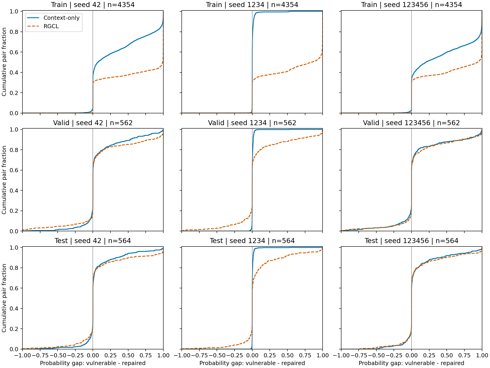
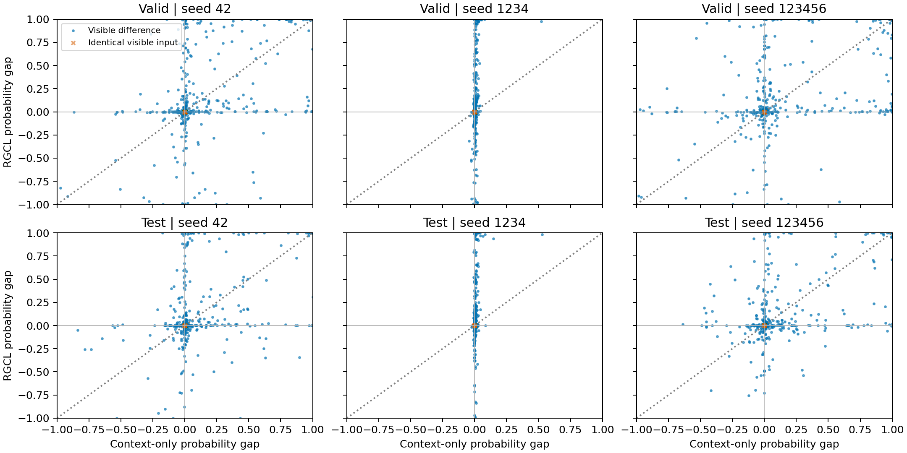

# RGCL 修复引导机制分析

仅使用 PrimeVul + UniXcoder 已完成的 Seed42、1234、123456 Context-only/RGCL。K=5、λ=0.1、Token 加权区域损失；不重新训练、不调整阈值或选模。六个 checkpoint 均核对完整16轮训练记录及原完整 Valid P-C 选择。Test Diff 仅用于事后统计。

## 分词、可见性和实际监督

复用正式 `RobertaTokenizerFast(trim_offsets=False)` 与 `paired_features`：原函数整体分词，不单独逐行分词或删除注释；不添加 UniXcoder 模式前缀。先保留前510个源码 BPE Token，再加 CLS/SEP，不足512补 Padding。空白 Token 消耗输入预算，但空白、特殊 Token 和 Padding 没有聚合质量；注释仍属于原始输入。物理行编号包含空行，底层从0计数。

Diff 沿用 `_line_diff`/`difflib.Differ` 的双向非空删除行规则，已逐函数核对持久化标签。完整可见指所有原始直接修改行的映射 Token 均在前510内；部分可见指至少一个修改 Token 可见，但并非所有修改行都完整；不可见指原本有直接修改行而一个修改 Token 也不可见。原侧无直接 Diff 单列，纯新增修复的漏洞侧属于这一类，不能当成截断。下表百分比以该侧全部函数为分母；只以非空 Diff 为分母的比例另存 coverage.json。

| 划分 | 侧 | 函数 | 完整 | 部分 | 不可见 | 无直接 Diff | 可施加区域损失 |
|---|---|---:|---:|---:|---:|---:|---:|
| train | all | 8708 | 4131 (47.44%) | 1061 (12.18%) | 2210 (25.38%) | 1306 (15.00%) | 5180 (59.49%) |
| train | vulnerable | 4354 | 1773 (40.72%) | 408 (9.37%) | 941 (21.61%) | 1232 (28.30%) | 2175 (49.95%) |
| train | repaired | 4354 | 2358 (54.16%) | 653 (15.00%) | 1269 (29.15%) | 74 (1.70%) | 3005 (69.02%) |
| valid | all | 1124 | 548 (48.75%) | 112 (9.96%) | 298 (26.51%) | 166 (14.77%) | 658 (58.54%) |
| valid | vulnerable | 562 | 230 (40.93%) | 37 (6.58%) | 132 (23.49%) | 163 (29.00%) | 266 (47.33%) |
| valid | repaired | 562 | 318 (56.58%) | 75 (13.35%) | 166 (29.54%) | 3 (0.53%) | 392 (69.75%) |
| test | all | 1128 | 531 (47.07%) | 128 (11.35%) | 270 (23.94%) | 199 (17.64%) | 659 (58.42%) |
| test | vulnerable | 564 | 219 (38.83%) | 47 (8.33%) | 109 (19.33%) | 189 (33.51%) | 266 (47.16%) |
| test | repaired | 564 | 312 (55.32%) | 81 (14.36%) | 161 (28.55%) | 10 (1.77%) | 393 (69.68%) |

实际区域损失要求可见前景和背景均非空；全区域及空区域不生效，函数 BCE 保留。PrimeVul 沿用历史规则，截断末行的可见部分仍可参与区域监督。跨行 Token 按1/归属行数分配，质量与 bounded_pool 一致，可能为分数 Token。三个种子的全部 Train 区域掩码均与同一统计核对，因此覆盖率不随种子变化。Train 为实际可用监督；Valid/Test 仅表示事后可用性，未输入推理。

| 划分 | 可见前景 Token质量 | 实际可用前景质量 | 对应背景质量 | 生效函数内前景均值/中位数/P95 | 含部分修改行的生效函数 | 全可见代码均为区域 |
|---|---:|---:|---:|---|---:|---:|
| train | 246063.000 | 245496.000 | 1395566.000 | 47.39 / 27.00 / 162.00 | 286 | 12 |
| valid | 31635.000 | 31608.000 | 168680.000 | 48.04 / 29.00 / 150.90 | 31 | 2 |
| test | 30115.000 | 30115.000 | 181132.000 | 45.70 / 27.00 / 153.90 | 29 | 0 |

区域损失为 `max(0, log(2) - log(mean_region_rate) + log(mean_background_rate))`，对生效函数平均。它在漏洞侧和修复侧都提高修改区域相对背景的平均倍率，没有直接要求这些行具有正漏洞 Logit，也没有直接最大化配对概率间隔。

## 预测间隔、排序与两侧均正确

Δp=P(漏洞函数)-P(修复函数)。严格排序要求 Δp>0；相等概率单列，不能计为正确排序。P-C 要求漏洞概率>0.5且修复概率≤0.5。P-V=两侧均判漏洞，P-B=两侧均判正常，P-R=两侧均判反。排序正确的 P-V/P-B 仍不是 P-C。所有预测以唯一 sample_key 加完整 pair_key、标签、物理行和 Token 质量核对，Valid/Test 指标与原评价文件完全一致。Train 复用两份历史预测，另四份只补做冻结单函数推理。

| 划分 | 种子 | 方法 | 对数 | Δp均值 | Δp中位数 | 正确排序 | 概率相等 | P-C | 排序正确但非P-C |
|---|---:|---|---:|---:|---:|---:|---:|---:|---:|
| train | 42 | context_only | 4354 | 0.331914 | 0.070946 | 2801 (64.33%) | 1254 | 1754 (40.28%) | 1047 |
| train | 42 | rgcl | 4354 | 0.618213 | 0.989224 | 3064 (70.37%) | 1254 | 2820 (64.77%) | 244 |
| valid | 42 | context_only | 562 | 0.090385 | 0.000000 | 248 (44.13%) | 164 | 88 (15.66%) | 160 |
| valid | 42 | rgcl | 562 | 0.099728 | 0.000000 | 250 (44.48%) | 164 | 103 (18.33%) | 147 |
| test | 42 | context_only | 564 | 0.063570 | 0.000000 | 237 (42.02%) | 163 | 77 (13.65%) | 160 |
| test | 42 | rgcl | 564 | 0.080860 | 0.000000 | 246 (43.62%) | 163 | 77 (13.65%) | 169 |
| train | 1234 | context_only | 4354 | 0.007792 | 0.000183 | 2390 (54.89%) | 1254 | 520 (11.94%) | 1870 |
| train | 1234 | rgcl | 4354 | 0.569923 | 0.843631 | 3048 (70.00%) | 1254 | 2705 (62.13%) | 343 |
| valid | 1234 | context_only | 562 | 0.004236 | 0.000000 | 270 (48.04%) | 164 | 48 (8.54%) | 222 |
| valid | 1234 | rgcl | 562 | 0.079044 | 0.000000 | 242 (43.06%) | 164 | 92 (16.37%) | 150 |
| test | 1234 | context_only | 564 | 0.004505 | 0.000045 | 296 (52.48%) | 163 | 56 (9.93%) | 240 |
| test | 1234 | rgcl | 564 | 0.075294 | 0.000000 | 259 (45.92%) | 163 | 83 (14.72%) | 176 |
| train | 123456 | context_only | 4354 | 0.410999 | 0.203459 | 2934 (67.39%) | 1254 | 1954 (44.88%) | 980 |
| train | 123456 | rgcl | 4354 | 0.588159 | 0.936685 | 3047 (69.98%) | 1254 | 2761 (63.41%) | 286 |
| valid | 123456 | context_only | 562 | 0.089493 | 0.000000 | 241 (42.88%) | 164 | 87 (15.48%) | 154 |
| valid | 123456 | rgcl | 562 | 0.099860 | 0.000000 | 262 (46.62%) | 164 | 100 (17.79%) | 162 |
| test | 123456 | context_only | 564 | 0.077964 | 0.000000 | 257 (45.57%) | 163 | 69 (12.23%) | 188 |
| test | 123456 | rgcl | 564 | 0.084372 | 0.000000 | 242 (42.91%) | 164 | 77 (13.65%) | 165 |

| 划分 | 种子 | 平均Δp变化 | 平均漏洞概率变化 | 平均修复概率变化 | 新增/丢失正确排序 | 新增/丢失P-C |
|---|---:|---:|---:|---:|---:|---:|
| train | 42 | +0.286299 | +0.151831 | -0.134468 | 281/18 | 1095/29 |
| valid | 42 | +0.009344 | +0.039883 | +0.030539 | 63/61 | 60/45 |
| test | 42 | +0.017290 | +0.038102 | +0.020812 | 88/79 | 47/47 |
| train | 1234 | +0.562131 | +0.259779 | -0.302352 | 684/26 | 2192/7 |
| valid | 1234 | +0.074808 | +0.053151 | -0.021657 | 61/89 | 72/28 |
| test | 1234 | +0.070789 | +0.047556 | -0.023233 | 61/98 | 63/36 |
| train | 123456 | +0.177160 | +0.084284 | -0.092876 | 147/34 | 873/66 |
| valid | 123456 | +0.010367 | +0.031572 | +0.021206 | 84/63 | 63/50 |
| test | 123456 | +0.006408 | +0.030507 | +0.024098 | 70/85 | 44/36 |

三种子汇总为均值±样本标准差（ddof=1，n=3）。每个种子评估同一批函数，不能把重复的成员当作三倍独立样本。分布内部标准差为ddof=0。

| 划分 | 子集 | 每种子对数 | Context Δp | RGCL Δp | Context排序% | RGCL排序% | Context P-C% | RGCL P-C% |
|---|---|---:|---:|---:|---:|---:|---:|---:|
| train | all | 4354 | 0.2502 ± 0.2137 | 0.5921 ± 0.0244 | 62.2033 ± 6.5134 | 70.1194 ± 0.2191 | 32.3687 ± 17.8376 | 63.4359 ± 1.3208 |
| train | visible_difference | 3100 | 0.3515 ± 0.3001 | 0.8316 ± 0.0342 | 87.3656 ± 9.1481 | 98.4839 ± 0.3077 | 45.4624 ± 25.0532 | 89.0968 ± 1.8550 |
| train | identical_input | 1254 | 0.0000 ± 0.0000 | 0.0000 ± 0.0000 | 0.0000 ± 0.0000 | 0.0000 ± 0.0000 | 0.0000 ± 0.0000 | 0.0000 ± 0.0000 |
| valid | all | 562 | 0.0614 ± 0.0495 | 0.0929 ± 0.0120 | 45.0178 ± 2.6927 | 44.7212 ± 1.7912 | 13.2266 ± 4.0589 | 17.4970 ± 1.0118 |
| valid | visible_difference | 398 | 0.0867 ± 0.0699 | 0.1311 ± 0.0169 | 63.5678 ± 3.8022 | 63.1491 ± 2.5293 | 18.6767 ± 5.7314 | 24.7069 ± 1.4287 |
| valid | identical_input | 164 | 0.0000 ± 0.0000 | 0.0000 ± 0.0000 | 0.0000 ± 0.0000 | 0.0000 ± 0.0000 | 0.0000 ± 0.0000 | 0.0000 ± 0.0000 |
| test | all | 564 | 0.0487 ± 0.0389 | 0.0802 ± 0.0046 | 46.6903 ± 5.3201 | 44.1489 ± 1.5759 | 11.9385 ± 1.8792 | 14.0071 ± 0.6142 |
| test | visible_difference | 401 | 0.0685 ± 0.0548 | 0.1128 ± 0.0064 | 65.6692 ± 7.4827 | 62.0948 ± 2.2165 | 16.7914 ± 2.6431 | 19.7007 ± 0.8639 |
| test | identical_input | 163 | 0.0000 ± 0.0000 | 0.0000 ± 0.0000 | 0.0000 ± 0.0000 | 0.0000 ± 0.0000 | 0.0000 ± 0.0000 | 0.0000 ± 0.0000 |

相同可见输入按正式512 Token ID序列相等定义；所有官方成员保留。额外的纯新增修复、两侧区域均完整、任一侧区域不可见子集及所有 P-C/P-V/P-B/P-R 迁移见 analysis.json，逐对结果见 paired_gaps.jsonl。完整分母包含不可见配对和概率相等配对。

## 实际发现

Train：平均Δp 0.250235 → 0.592098；P-C 32.37% → 63.44%；严格正确排序 62.20% → 70.12%。

Valid：平均Δp 0.061372 → 0.092877；P-C 13.23% → 17.50%；严格正确排序 45.02% → 44.72%。

Test：平均Δp 0.048680 → 0.080175；P-C 11.94% → 14.01%；严格正确排序 46.69% → 44.15%。

RGCL 的平均间隔在三个种子的 Valid/Test 均增加，但 Test 严格排序只在Seed42增加，Seed1234/123456下降；Valid 为两个增加、一个下降。平均间隔是幅度统计，正确排序是符号统计，不能相互替代。Test P-C 两个种子提高、一个持平，同时新增/丢失P-C分别为47/47、63/36、44/36。各模型的严格排序正确配对中，仍有大量 P-V/P-B；没有依据宣称模型普遍更容易排对前后版本。

仅看Test中有可见差异的401对，P-C 16.79% → 19.70%，排序 65.67% → 62.09%，结论仍相同。相同可见输入的163对在六个模型中概率均相等，Δp和P-C均为0；这部分没有通过修改评价分母被剔除。

Test 的平均漏洞概率变化为 +0.038722，修复概率变化为 +0.007226。因此平均间隔扩大并不等于总体修复侧概率下降。Seed42/123456 的两侧平均概率都升高，只有Seed1234修复侧均值下降。三种子Test的修复侧FPR从51.77%升至55.38%，MCC从0.096398略降至0.095362；P-C收益不代表整体误报下降。

Train中有可见差异配对的RGCL正确排序为98.48%、P-C为89.10%，Test对应为62.09%、19.70%。训练集的分离能力没有同幅度迁移到未见样本。已有最佳轮次分别为Context-only 14/5/16、RGCL 16/13/14（种子42/1234/123456）；Seed1234的Context-only概率尤其集中在0.5附近。不能把所选模型的全部差异解释成同一个训练时刻增加Diff损失的直接作用。

## 分布图

[可编辑SVG](probability_gap_ecdf.svg)。每条曲线包含该划分全部配对；0处跳跃包含概率相等的配对。

[可编辑SVG](paired_gap_changes.svg)。每个点对应一对函数，无抖动或样本删除；重叠点不会展示为独立密度。

## 案例与解释

原始源码、真实Diff、逐种子概率及代码语义核对见 [案例分析](cases.md)。候选按跨种子新增P-C、丢失P-C、排序正确但两侧判漏洞、持续失败、相同可见输入分组，各组优先短函数，完整规则见 write_case_candidates。案例用于解释已有结果，不用于选模型或阈值。

概率变化只能说明函数输出变化，不能由此推断模型关注了哪些行。独立训练并按Valid选择的模型可能选中不同Epoch；这些事后比较描述与Diff监督相关的现象，不能独立证明具体代码行的注意力或因果中介作用。

复现统计和图：`python -m vulnmechanism.cli rgcl-mechanism --device cuda:0`。缺失Train预测保存在新分析目录的本地cache，不改写任何历史目录、checkpoint或数据。26项相关最小测试记录见 tests.log；首次检查发现并修复了空侧分母的统计异常，未放宽断言。checks.json 另记录18组预测、65,760条函数记录、各子集统计恒等式、所选Epoch及12段案例原文的一致性核对。
