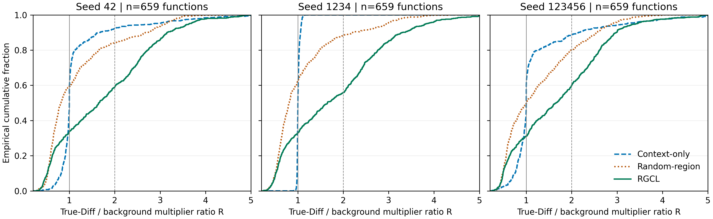

# RQ4：Repair-Guided Region Attention Analysis

本轮仅冻结分析官方PrimeVul Test、UniXcoder、Seed42/1234/123456的Context-only、Random-region、RGCL九个既有checkpoint。未训练、改阈值、改选模或改动RQ1–RQ3。

## 统计口径与共同集合

复用正式bounded_pool的行倍率rᵢ=1+4·sigmoid(sᵢ)，范围[1,5]；有效Token质量nᵢ来自物理行映射。跨行Token在所属物理行之间均分其一个Token的质量，CLS/SEP/Padding及非代码空白不计。行归一化注意力aᵢ=nᵢrᵢ/Σⱼnⱼrⱼ，不能直接把aᵢ当作行倍率。

R=(ΣDiff nᵢrᵢ/ΣDiff nᵢ)/(Σ背景 nᵢrᵢ/Σ背景 nᵢ)，直接调用正式bounded_region_record，与attention_region_loss(weighting='token')一致；每个函数产生一个R，函数间不按长度加权。

全部1128个函数（564对）均完成前向；其中659个函数区域与背景同时有正Token质量，占58.42%。排除无可见有效区域469个、有区域但无背景0个。三方法、三种子严格使用这一相同集合，不按预测或R筛选。

编码保持整个源码的原有BPE与offset映射：前510个源码Token加CLS/SEP、Padding至512。沿用PrimeVul历史规则，截断末行的可见Token仍可统计。Test Diff只在九次完整源码前向结束后读取，不进入前向loader或模型参数；Random-region也使用相同真实Test Diff作事后区域划分。

## 三种子完整分布

| Seed | 方法 | 函数数 | R均值 | R中位数 | 四分位区间 | R>1 | R≥2 |
|---|---|---:|---:|---:|---|---:|---:|
| 42 | Context-only | 659 | 1.1865 | 0.9999 | [0.9369, 1.0546] | 43.85% | 7.74% |
| 42 | Random-region | 659 | 1.1820 | 0.8165 | [0.6149, 1.4686] | 40.67% | 15.78% |
| 42 | RGCL | 659 | 1.7633 | 1.6519 | [0.7097, 2.5585] | 66.31% | 40.97% |
| 1234 | Context-only | 659 | 1.0117 | 1.0019 | [0.9918, 1.0240] | 55.24% | 0.00% |
| 1234 | Random-region | 659 | 1.1020 | 0.8042 | [0.6073, 1.3420] | 37.63% | 11.84% |
| 1234 | RGCL | 659 | 1.8028 | 1.6538 | [0.7328, 2.5831] | 67.07% | 44.16% |
| 123456 | Context-only | 659 | 1.2411 | 1.0000 | [0.8971, 1.1038] | 42.03% | 11.38% |
| 123456 | Random-region | 659 | 1.2770 | 1.0105 | [0.5873, 1.8055] | 50.38% | 19.58% |
| 123456 | RGCL | 659 | 1.7185 | 1.6574 | [0.7770, 2.4876] | 68.89% | 40.06% |

R>1表示区域每Token倍率高于背景；R≥2对应原辅助损失的零惩罚目标，均非搜索阈值。完整最小值、最大值、5/25/50/75/95百分位及同一种子内函数间R的标准差见region_summary.csv与rq4.json。



图中ECDF包含全部合格函数，无分箱、平滑或有利样本选择；三面板共享横轴[0.2,5]及纵轴[0,1]。曲线整体向右表示更大的R，竖线分别为1和2。可编辑矢量图见region_ratio_ecdf.svg。

## 跨种子汇总与同函数比较

下表为三个种子的函数均值/中位数的均值±样本标准差（ddof=1），重复单位是三个种子，而不是将同一批659个函数重复计算成独立的3倍样本。

| 方法 | R均值的均值±SD | R中位数的均值±SD |
|---|---:|---:|
| Context-only | 1.1464 ± 0.1198 | 1.0006 ± 0.0011 |
| Random-region | 1.1870 ± 0.0876 | 0.8770 ± 0.1157 |
| RGCL | 1.7615 ± 0.0422 | 1.6543 ± 0.0028 |

同一函数上计算ΔR=R_RGCL−R_对照，不改变区域或背景大小：

| Seed | 对照 | 平均ΔR | 中位ΔR | R增加的函数比例 |
|---|---|---:|---:|---:|
| 42 | Context-only | +0.5768 | +0.4089 | 61.76% |
| 42 | Random-region | +0.5813 | +0.4149 | 66.16% |
| 1234 | Context-only | +0.7911 | +0.6486 | 66.92% |
| 1234 | Random-region | +0.7007 | +0.4973 | 68.29% |
| 123456 | Context-only | +0.4774 | +0.3366 | 62.37% |
| 123456 | Random-region | +0.4415 | +0.2834 | 62.82% |

## 损失目标、实际权重和分类结果的区别

正式区域损失为合格函数上的mean ReLU(log(2)−log R)，权重0.1，与函数BCE联合训练。它希望训练Diff区域的每Token平均倍率达到背景的至少两倍；有界倍率和函数分类目标同时约束优化。Test的R是未见函数上实际学到的权重分布，不是额外施加损失后的结果，也不要求每个函数都达到2。

分类指标仍由各历史checkpoint在固定prob>0.5下决定。下面仅列完整1128函数/564对的已有指标以区分证据，不将区域统计的合格子集用于替换正式分类评价分母。

| Seed | 方法 | 原Test P-C | 原Test MCC |
|---|---|---:|---:|
| 42 | Context-only | 13.65% | 0.1016 |
| 42 | Random-region | 13.12% | 0.0819 |
| 42 | RGCL | 13.65% | 0.0885 |
| 1234 | Context-only | 9.93% | 0.0951 |
| 1234 | Random-region | 11.35% | 0.0590 |
| 1234 | RGCL | 14.72% | 0.1091 |
| 123456 | Context-only | 12.23% | 0.0925 |
| 123456 | Random-region | 11.35% | 0.0846 |
| 123456 | RGCL | 13.65% | 0.0885 |

完整Test三种子平均P-C / MCC分别为：Context-only 11.94% / 0.0964；Random-region 11.94% / 0.0752；RGCL 14.01% / 0.0954。这些分类结果不由R的提高直接推出。

## 中文结论

相对Context-only，RGCL的平均R在3/3个种子上增加；平均ΔR的跨种子汇总为0.6151 ± 0.1603。
相对Random-region，RGCL的平均R在3/3个种子上增加；平均ΔR的跨种子汇总为0.5745 ± 0.1298。

不利结果同样保留：RGCL仍平均有32.57%的合格函数R≤1，且相对Context-only、Random-region分别有36.32%、34.24%的函数R没有增加。ECDF在部分区间交叉，不能把均值和中位数上升解释为每个函数的权重都更高。

九个冻结模型在共同Test函数集合上的结果支持：真实修复区域监督改变了权重分配，且三个种子中对真实Diff区域的相对偏向均高于Context-only和Random-region。
这一观察不证明模型理解了漏洞语义，也不证明权重变化直接造成分类改善；局部倍率分布与函数分类是不同证据。三个种子和一个数据集支持的结论不应扩大为其他数据集的一般规律。

## 复现与检查

```bash
/home/phy/miniconda3/envs/vul-detect/bin/python -m vulnmechanism.cli rgcl-mechanism \
  --analysis region-attention --device cuda:0
```

九个checkpoint路径、原始Valid选中Epoch、环境、预测/倍率最大误差见rq4.json。全部Test统计使用与历史评价相同的FP32 Batch8前向，复核容差rtol=1e-5、atol=1e-6，分类决定完全相同。单函数/批次计算等价性另用FP64诊断复核（rtol=1e-9、atol=1e-11），不将FP64诊断输出用于区域统计或替换原始预测。checks.json记录源码单函数前向、与原Test预测及行权重一致、同一集合和Token质量核对。test.regions.jsonl保存共同区域定义，function_regions.jsonl保存全部逐函数R；不包含原始源码、Token ID或模型权重。最小测试日志为tests.log。

FP64单函数/Batch8行倍率最大绝对误差为2.665e-15。初次使用FP32进行单函数数值一致性检查时，Seed1234 RGCL的行倍率出现3.60×10⁻⁵差异，概率差为7.75×10⁻⁷、Token质量差为0；CPU复核也存在相近量级的舍入差异（TF32关闭）。因此改用更高精度检验数学等价性，正式FP32前向及区域统计保持不变。原始中断和逐项数值记录保存在analysis.single_check_failure.log与single_function_numerics.json。

另一次中断来自错误地要求所有历史预测均含logit：Seed123456的Context-only和RGCL文件只保存概率等字段。现按实际保存的字段完整核对，不补造历史logit；包含logit的文件额外核对该字段。对应记录为analysis.legacy_schema_failure.log；修复后最小测试通过，并完成全部九组复核。此次运行复用本分析中已完成且与原始预测匹配的6组FP32前向缓存，3组现算；所有九个checkpoint仍逐一加载并完成FP64单函数诊断，未修改任何权重。
